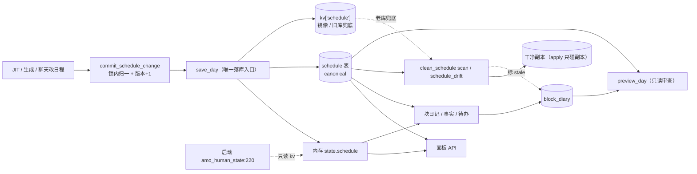

# 能陪 · 架构与数据流（交接页）

> 对象：接手 `Astrbot_amoupup_forever`（能陪）的开发者 / 维护 agent。
> 实测时间 2026-11-17；解释器 `D:/dafeiyu/uv/tools/astrbot/Scripts/python.exe`（Python 3.12.16 / pytest 9.2.0）。
> 本文只写当前代码里真实存在的东西；数字均为当时实测，命令与口径见 §6。

## 0. 一分钟版

能陪是一个「过日子」的陪伴插件：按小时推进日程（JIT），把发生过的事写进块日记，再用回复守卫保证说出口的话不与日程/事实/地点冲突。
它自身只认三个数据源：**schedule 表**（日程 canonical）、**kv**（状态与旧库镜像）、**block_diary / schedule_diary**（日记缓存）。
其它一切（面板、清理、巡检、仿真）都是这三者的只读或受控写入。

## 1. 三个插件：角色与边界

| 插件 | 一句话职责 | 对外契约 | 依赖方向 |
|---|---|---|---|
| **能陪** `Astrbot_amoupup_forever` | 人格、日程、日记、回复主循环；库为 `plugin_data/Astrbot_amoupup_forever/amo_forever.db` | 约会状态 kv `date_session`（`amo_date_session.py:1-6`「唯一真相」）；给守护/能记的调用面 | 依赖 → 能记、守护 |
| **能记** `Astrbot_amoupup_data` | 长期记忆与消息库，门面 `core/api.py` 的 `MemoryAPI`（`self.mem`） | `mem.xxx(...)`，能陪经 `self._data_call("xxx")` 调用（`amo_memory_data.py:147`） | 不 import 能陪引擎（只在 README / 测试里出现 forever） |
| **守护** `Astrbot_amoupup_watch` | 独立社会模拟插件，四层 guard/runtime/store/scheduler，握手只调 `describe()` | `describe()` 同步纯内存摘要（`watch/main.py:1-8`） | 只读能陪的约会状态面（`watch/core/amo_bridge.py`、`watch/services/date_engine.py`、`watch/tests/contracts/Astrbot_amoupup_forever_surface.json`） |

**依赖方向是单向的**：`forever → data`、`forever → watch`、`watch → forever 的公开面（date_session）`。
能陪调用能记用的是**字符串方法名**，所以最容易漏检；`tests/test_cross_plugin_contract.py` 按字面量逐个核对对方源码里是否真有该方法（对方不在本机则自动跳过）。

## 2. 能陪模块地图

分层：**纯函数/数据** → **状态层** → **引擎** → **集成层（api / runtime / commands / main）**。

| 模块 | 一行说明 |
|---|---|
| `amo_timeline.py` | Timeline：日程块身份 `block_id` / 读写 / 查询的唯一实现（`amo_state_common` 只转发） |
| `amo_date_session.py` | 约会会话单一源：一个 kv `date_session` 管窗口/地点/是否面对面/收尾 |
| `amo_date_context.py` / `amo_date_facts.py` | 约会状态的提示词注入与事实渲染（结束即「各回各家」） |
| `amo_fact_timeline.py` | FactTimeline：当天/时段事实的唯一时间线（+ `amo_fact_pool` 素材、`amo_fact_binder` 绑定） |
| `amo_config_model.py` | ConfigModel：以 `_conf_schema.json` 为单一真相的配置读取（cfg/cfg_int/…唯一实现） |
| `amo_prompt_registry.py` | PromptRegistry：主聊天提示词块的唯一登记处（id/tag/顺序/lean/通道） |
| `amo_state_store.py` | kv 状态仓：命名登记、TTL 判定、只读健康报告、dry-run 清理 |
| `amo_reply_pipeline.py` | ReplyPipeline：回复守卫的**有序登记表**（generate/decorate/send/proactive_pre 四阶段） |
| `amo_reply_gate.py` | 群聊插话 / 私聊回复概率打分；不碰数据库、不发消息 |
| `amo_state_schedule.py` | 日程状态机 mixin：生成、待办/行程、展示优先级、`save_day`、`commit_schedule_change` |
| `amo_schedule.py` / `schedule_engine.py` / `schedule_*.py` | 日程引擎与骨架/分段/假期/景点/游泳/社交/主题等纯规则 |
| `amo_schedule_tools.py` | 日程/天气/消费的 LLM 工具：只执行模型的选择，不替模型决定 |
| `amo_schedule_health.py` | 健康↔日程一致性巡检（好了就删病假块） |
| `amo_transition.py` | 过渡引擎：跨地点/跨状态按真实物理时间分步；`normalize_day` 读侧去重叠 |
| `amo_location_rules.py` | 地点物理法则：地点 → 允许/禁止词（纯数据+纯函数，不 import 引擎） |
| `wardrobe.py` + `wardrobe_*.py` | 衣柜：每日一套、面板增删、礼物入库、7 个模块拆分（data/seed/daily/queries） |
| `photo_engine.py` + `photo_*.py` | 照片：场景时刻按概率经 OmniDraw 生成；`photo_plan.build_plan()` 是唯一计划入口 |
| `heartflow_engine.py` + `heartflow_*.py` | 心流（事件/模型/状态/文本）评分与数据层 |
| `amo_jobs.py` | 统一后台任务管理器（register/interval/backoff/timeout 契约，三插件同语义） |
| `amo_observability.py` | 吞异常也要留痕：计数 + 限流 warning，`/status` 可查；叶子模块 |
| `amo_api*.py` / `amo_route_table.py` | API 层：handler mixin + 路由表（`ROUTE_COUNT_EXPECTED = 97`），面板 `views/dashboard/` |
| `main.py` / `amo_runtime*.py` / `amo_commands.py` | 装配入口（814 行）与运行时/指令；只组合，不承载领域规则 |

**反向依赖红线**（新增代码时照此审）：
1. 纯函数/数据层（`amo_location_rules`、`day_types`、`clock`、`amo_shared`、`amo_observability`）不得 import 引擎、插件实例或 api；`amo_location_rules.py:1-13` 已明确「不 import 插件引擎」。
2. 引擎（schedule/diary/reply/photo/…) 不得 import `amo_api*` / `amo_runtime*` / `amo_commands` / `main`。
3. api 层只依赖 state/db/纯函数；state 不得为了面板方便反向 import api。
4. 能陪不得直接读写能记/守护的库表（只能走 `mem` / `describe()`）。

## 3. 数据流与 canonical 源

### 3.1 两份存储 + 一份内存

| 位置 | 角色 | 代码 |
|---|---|---|
| `schedule(day TEXT PRIMARY KEY, items TEXT, updated REAL)` | **canonical**：日程唯一可信源；面板/日记/事实/待办最终都以它为准（读侧内存优先、回落此表） | DDL `amo_db.py:287`；`save_schedule` `:1032`；`get_schedule` `:1087` |
| `kv["schedule"]` = `{day: [块…]}` | **镜像**，只为旧库兜底；启动时载入内存 | 读 `amo_human_state.py:220`；写只出现在 `save_day` 内 |
| `state.schedule`（内存 dict） | 进程内读改写的工作副本；读侧**内存优先**，空了才回落表 | 典型写法 `self.schedule.get(day) or self.db.get_schedule(day) or []`（`amo_api_schedule.py:562`、`amo_schedule.py:212/378/474`、`amo_state_date.py:91`…） |
| `block_diary(day, block_id, start, end, place, text, status…)` | 块日记缓存，`status` 可为 valid/stale/frozen/archived | DDL `amo_db.py`；读写 `amo_state_diary.py:345+`、`amo_db.py:1269/1281` |
| `schedule_diary(day, hour, text, version, status)` | 旧「每小时小日记」缓存，仍参与失效 | DDL `amo_db.py:1103`；`mark_diaries_stale` `:1169` |

### 3.2 写入只有两条路，落库只有一个口

```
生成/JIT/聊天改日程 ──► commit_schedule_change(day, new_items, source=…)
                          └─ 锁内 _commit_schedule_change_locked:
                             归一（清文案→归一地点→纠主语）→ 重叠兜底 → 版本 +1
                             → 整份替换写入
                          └─► save_day(day, rows)
                                ├─ state.schedule[day] = rows     （内存）
                                ├─ db.save_schedule(day, rows)    （schedule 表）
                                └─ db.kv_set("schedule", …)       （kv 镜像）
```

- `save_day` 是**唯一落库入口**（`amo_state_schedule.py:450`）：表 + kv 必须同一次写完。
  文档字符串记录了 2026-11-17 事故：`amo_runtime_tick` 只调 `db.save_schedule`，于是表 26 项、kv 25 项，
  清理脚本读 kv 永远看不到 06:12 那块 finance。`tests/test_schedule_save_entry.py:1-6` 把这个语义钉死。
- 未来日期**不铺日程**（防剧透）：`commit_schedule_change`（`amo_state_schedule.py:190`）对 `day > today` 只登记待办，到点由 JIT 落实。
- 任何「只写表」或「只写 kv」的新代码都是回归，评审直接拒。

### 3.3 block_diary 与日程块的级联

块身份 = `block_id(day, block)`（`amo_timeline`）。所以：

```
日程块被删/被截断/被改时间
  └─ 写侧：mark_diaries_stale(day, from_hour)（amo_db.py:1169）
           └─ 顺带 mark_block_diaries_stale(day, from_start)（:1269）→ 该起点及以后的块日记 status='stale'
  └─ 质检侧：mark_block_diary_stale(day, block_id)（:1281）→ 只打这一块
  └─ 清理侧：scan 发现 block_diary 的 day+start+end 在日程里已不存在 → orphan_block_diary（HARD）→ apply 标 stale
```

**stale 不删正文**：旧文本保留给生成失败时兜底；`frozen` / `archived` 是人工冻结，任何自动清理都不许动
（`amo_db.py:1169` 的 `status NOT IN ('stale','frozen','archived')`；`work/clean_schedule.py` 同口径）。
`delete_day` 才清理当天全部日记行。

### 3.4 谁读哪一份（改存储前必须逐个看）

| 读侧 | 读法 |
|---|---|
| 面板 API（日程页） | 内存优先 + 表兜底（`amo_api_schedule.py:562`） |
| 日记/事实/待办/过渡 | 内存优先 + 表兜底（`amo_state_diary.py:234/384/647`、`amo_fact_timeline.py:623`、`amo_transition.py:1271`） |
| `work/preview_day.py` | **表优先**，kv 只给老库兜底（`:37` `_items_of`） |
| `work/clean_schedule.py` | `load_schedule` 表优先、kv 兜底；`schedule_sources` 报 `in_sync`（`:345`、`:353`） |
| `work/schedule_drift.py` | 直接复用 `clean_schedule.scan_plan`，只读 |
| 测试 / 仿真 | FakeDB 双写（`tests/test_schedule_save_entry.py`）或内存库 |

### 3.5 数据流图



## 4. 不变量清单

| # | 不变量 | 落点 | 谁兜底 |
|---|---|---|---|
| I1 | **无重叠**：同一天 `[start,end)` 不交叠，无 <5 分钟碎片 | 写侧 `_normalize_schedule_items` + `_commit_schedule_change_locked`（`amo_state_schedule.py:539`）；读侧 `amo_transition.normalize_day`（`:1332`，较早块优先、后块截断、碎片并入前块）；跨地点瞬移先补通勤（`transit_repair`） | `clean_schedule` overlap、`preview_day` HARD overlap/fragment、`tests/test_schedule_invariants.py` |
| I2 | **文案与地点一致**：`place=家` 不能写「楼下/出去」，`zone=road` 不能写「在工位」 | `amo_location_rules`（地点→允许/禁止词）；`_enforce_zone_activity`；写侧 `normalize_place` | `clean_schedule` activity_place（HARD，set_activity）；`preview_day` no_transit / missing_outbound |
| I3 | **财务不插睡眠**：00:00–06:00 不许有工资/支出/入账块，财务流水不打断约会 | 巡检口径 `_night_finance`（`work/clean_schedule.py`，`NIGHT_END_MINUTES=6*60`）；展示层「社交/约会进行中，财务只留账本」（`amo_state_schedule.py:953`） | `clean_schedule` night_finance（HARD delete_block）；**写入侧没有硬拦截**，属扫描兜底 |
| I4 | **日记不编互动**：素材里没有的「他打电话/抱我/买药/来看我」不许写 | `amo_diary_guard.claims_today_interaction` + `strip_fabricated_interaction`（按句改写而非整段丢情绪）；约会结束后禁同住词 `amo_date_context` | `preview_day` 约会后同住词 HARD；`tests/test_diary_fabrication_guard.py` |
| I5 | **回复不矛盾**：说出口的必须与当前时段/地点/约会状态/消费一致 | `amo_reply_pipeline` 四阶段登记表（`send` 与 `proactive_pre` 已接管；generate/decorate 只登记）；`amo_immersion_guard` 时间标签；`looks_like_model_leak` | `tests/test_reply_pipeline.py`、`test_reply_fact_guard.py`、`test_place_guard.py` |
| I6 | **单一日程存储**：任何写入都必须 table + kv + 内存同时更新 | `save_day`（`:450`）；`kv_set("schedule")` 全仓只有它一处 | `tests/test_schedule_save_entry.py`；`clean_schedule.schedule_sources.in_sync` |
| I7 | **未来不剧透**：未来日期只存待办，不铺具体日程 | `commit_schedule_change` 的 `day > today` 分支 | `clean_schedule` future_day（HARD delete_day）；`tests/test_schedule_future.py` |
| I8 | **stale 不删正文**：失效只打标，正文留审计 | `mark_diaries_stale` / `mark_block_diaries_stale` | `status NOT IN ('stale','frozen','archived')` 是硬约束 |

## 5. 失败模式与排查

| 失败模式 | 症状 | 怎么发现 | 怎么处理 |
|---|---|---|---|
| **双存储漂移** | 面板能看到某块，清理/巡检扫不到（或反之） | `python work/schedule_drift.py` exit 1；`clean_schedule.scan` 的 `schedule_sources.in_sync` 为 false | 以表为准：在**副本**上 apply，确认 0 后人工停机替换；然后用当天的表数据走一次 `save_day`，把内存/kv 对齐 |
| **孤儿块日记** | 日记页有一段「已经不存在的时间块」 | `clean_schedule scan` 的 `orphan_block_diary`（HARD） | apply 只标 `status='stale'`（`stale_block_diary`）；要重写就让它按新块重算 |
| **内存旧态** | 库/面板已经变了，插件仍按旧日程回复；重启后「自己好了」 | 日志里没有写日程，但 `schedule` 表 `updated` 变了；面板与对话内容对不上 | 内存只在启动时 `kv_get("schedule")` 载入一次（`amo_human_state.py:220`）：外部改库后必须**重载插件/重启**才生效；不要用「再跑一次扫描」当修复 |
| **提示词示例被当事实** | 当天 0 条聊天，块日记却写「他早上提醒我多喝水」 | `amo_diary_guard.py:60-65` 记录过实锤；用 `work/diary_audit.py` 抽查 + `preview_day` HARD 判据 | 守卫按句清洗成安全句（不整段丢情绪）；同时**改掉提示词里的示例句**，只改代码不改提示词会复发 |
| **文案/地点矛盾** | 「在医院排队」却写「倒在床上、茶几上外卖」 | `preview_day` HARD / `clean_schedule` activity_place | `set_activity` 纠文案，物理字段（place/zone）保留 |
| **夜间财务块** | 03:00 出现「工资到账」 | `clean_schedule` night_finance / `preview_day` | HARD 删块；查记账写入侧为何用凌晨时间戳 |
| **过期病假** | 健康已恢复，日程还挂着病假 | 每轮 tick 的 `reconcile_health_schedule` 会记日志；`tests/test_schedule_health.py` | 自动物理删除病假行，再归一后落库（`amo_schedule_health.py`） |
| **旧库没表** | 新装/迁移后读不到日程 | `clean_schedule` 的 `has_table=false`、`source="kv"` | 允许 kv 兜底，但**只读兜底**；一旦表存在就必须以表为准（`load_schedule` 的注释即 2026-11-17 教训） |

## 6. 验证命令

### 6.1 当前基线（2026-11-17 实测，勿照抄旧数字）

- `pytest -q`：**3189 passed / 7 skipped / 40 subtests passed**（39.06s）。旧交接材料写的 3123 是更早的树。
- `work/structure_audit.py`：扫 460 个 `.py`；`main.py` 814 行；**>1800 行文件 0**；**>120 行函数 1**——唯一一个在 `work/clean_schedule.py:454 plan_items`（122 行，work 脚本，不是生产模块）；TODO/FIXME 0。
  注意口径差异：结构审计把 `work/` 算进去，而 `tools/quality_gate.py` 的函数预算只在 ≥250 行警告、≥400 行失败（`FUNC_WARN_LINES/FUNC_FAIL_LINES`），所以「gate 全绿」与「审计 1 个超 120 行」可以同时成立。
- 路由 `97`（`amo_route_table.ROUTE_COUNT_EXPECTED`，`check_routes` 会红）。

```bash
PY="D:/dafeiyu/uv/tools/astrbot/Scripts/python.exe"   # 本机 python 不在 PATH 上；能陪的 pytest 装在这个 uv tool env

# 1) 全量单测
"$PY" -m pytest -q

# 2) 质量门（schema / 编译 / 路由契约 / 面板 JS / pyflakes / 体积 / 函数长度 / 静默 except / 异步阻塞 / 单测）
"$PY" tools/quality_gate.py            # --fast 跳过全量单测

# 3) 结构审计
"$PY" work/structure_audit.py [--json]

# 4) 离线仿真（不连真库、不调真模型）
"$PY" work/simulate_day.py   [--date 2026-11-16] [--city 东莞] [--trip]
"$PY" work/simulate_24h.py
"$PY" work/simulate_weeks.py --days 7   # 或 --days 15

# 5) 真实库只读：清理计划 / 漂移 / 一天审查
"$PY" work/clean_schedule.py scan --db <db> --today 2026-11-17 --out plan.json
"$PY" work/schedule_drift.py [--db <db>] [--today 2026-11-17] [--json]
"$PY" work/preview_day.py [--date 2026-11-16] [--html out.html] [--now 19:30]
```

### 6.2 只读与安全约定

- `clean_schedule scan`：`mode=ro` 只读打开，打不开就 sqlite backup 热快照到临时文件再扫，**绝不写真库**。
- `apply`：拒绝真实库目录（路径含 `plugin_data`）、拒绝非插件库、拒绝错误 digest；先备份副本，再在单事务里「写 `cleanup_audit` → 执行 → 复扫断言 0」，失败整体回滚。**产物是干净副本**，线上替换是人工停机窗口的动作。
- `schedule_drift`：exit 0 干净 / 1 有漂移 / 2 拒绝（库不存在、不是插件库、参数错）。
- 退出码是契约：脚本 0 不代表「没看不完的部分」，要看 `counts` 与 `digest`。

## 7. 变更规则

### 7.1 改日程生成 / 归一逻辑

必跑：`tests/test_jit_schedule.py`、`test_schedule_engine_split.py`、`test_schedule_invariants.py`、`test_schedule_skeletons.py`、`test_schedule_future.py`、`test_transition*.py`、`test_consistency_24h.py`、`test_schedule_structure.py`；
再跑 `work/simulate_day.py` 与 `simulate_24h.py`（要动多月行为再加 `--days 15`），最后用 `preview_day` 看真实库那天是否还 0 HARD。

### 7.2 改存储（表 / kv / 内存 / 日记行）

同时改这些读侧，否则必然漂移：
1. `amo_state_schedule.save_day`（唯一写入口）与 `amo_human_state` 的启动载入；
2. 内存优先的读侧：`amo_api_schedule.py`、`amo_state_diary.py`、`amo_state_date.py`、`amo_state_todo.py`、`amo_fact_timeline.py`、`amo_transition.py`、`schedule_skeleton.py`；
3. 只读工具：`work/preview_day.py`、`work/clean_schedule.py`（`load_schedule`/`schedule_sources`）、`work/schedule_drift.py`；
4. 旧库兜底（`kv["schedule"]`）与迁移测试 `tests/test_schedule_save_entry.py`、`test_amo_db.py`、`test_schema_retention.py`。
新增字段要写进 `clean_schedule.ITEM_FIELDS`，否则 apply 计划会丢字段。

### 7.3 改日记 / 回复守卫

- 日记：`tests/test_block_diary.py`、`test_schedule_diary_chain.py`、`test_diary_fabrication_guard.py`、`test_diary_orphan_guard.py`、`test_diary_guard.py`；用 `work/diary_audit.py` 抽查真实库。
- 回复：`tests/test_reply_pipeline.py`（顺序即契约）、`test_reply_guard.py`、`test_reply_fact_guard.py`、`test_place_guard.py`、`test_clean_reply_guard.py`。改顺序 = 改契约，必须同步登记表与测试。

### 7.4 什么时候需要重载 / 重启

- **改 Python（含路由、守卫、提示词登记表）**：重载插件，且推荐整机重启 AstrBot——README 明确记过「只重载插件不够，旧 Web API 路由会残留」（`README.md:679`、`:705`）。
- **改 `views/dashboard/` 静态资源**：浏览器硬刷新即可，不用重启。
- **改面板配置项并保存**：原生配置页保存后会自动重读配置，天气/管理员/日期等动态项无需重载（`README.md:808`）；但 `_conf_schema.json` 结构变化仍要重载。
- **改库（扫描/apply 的副本替换）**：属于停机动作；替换后内存里的 `state.schedule` 仍是旧值，必须重启。

## 8. 关键文件索引

| 主题 | 文件:行 |
|---|---|
| 唯一落库入口 / kv 镜像 | `amo_state_schedule.py:450`（save_day）、`:463-466` |
| 日程提交（锁 + 归一） | `amo_state_schedule.py:190`、`:539`、`amo_transition.py:1332`（normalize_day） |
| 启动载入内存 | `amo_human_state.py:220` |
| 表 / 日记 schema 与失效 | `amo_db.py:287`、`:1032`、`:1087`、`:1103`、`:1169`、`:1269`、`:1281` |
| 清理口径（含事故注释） | `work/clean_schedule.py:1-27`（docstring）、`:345`（load_schedule）、`:353`（in_sync）、`:454`（plan_items） |
| 只读审查 | `work/preview_day.py:37`、`review()` |
| 漂移巡检 | `work/schedule_drift.py`（exit 0/1/2） |
| 结构审计 / 质量门 | `work/structure_audit.py`、`tools/quality_gate.py`（`FUNC_WARN_LINES=250`、`FUNC_FAIL_LINES=400`） |
| 回复流水线顺序 | `amo_reply_pipeline.py:1-58` |
| 日记反加戏 | `amo_diary_guard.py:55-130` |
| 地点法则 | `amo_location_rules.py:1-13` |
| 约会单一源 | `amo_date_session.py:1-6` |
| 跨插件契约 | `tests/test_cross_plugin_contract.py`、`tests/contracts/` |

> 术语：**canonical** = 唯一可信源；**JIT** = 到点按需生成该小时日程；**block_id** = `block_id(day, block)` 的块身份；
> **stale** = 失效但保留正文的日记行；**drift** = 表与 kv（或内存）不一致；**gate** = `tools/quality_gate.py`。
